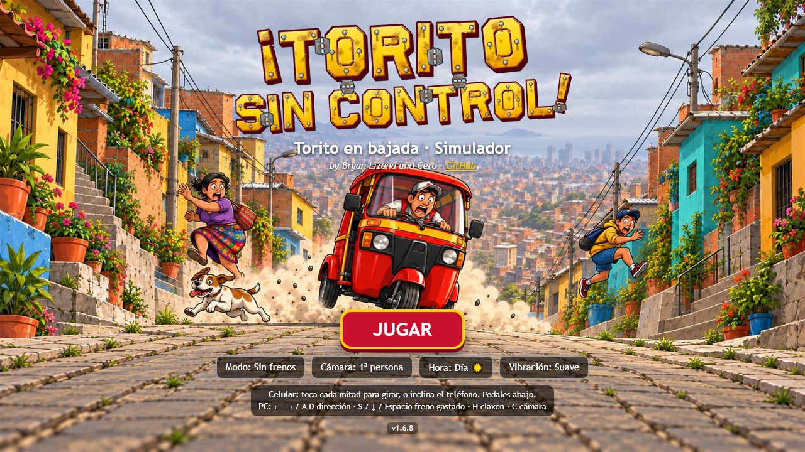
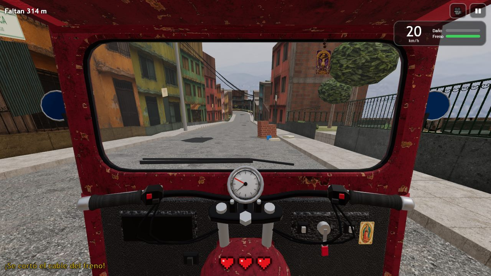
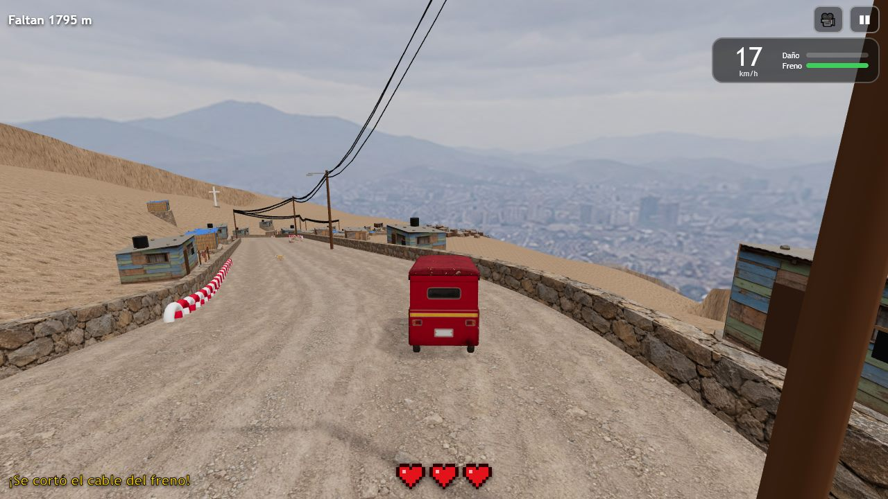
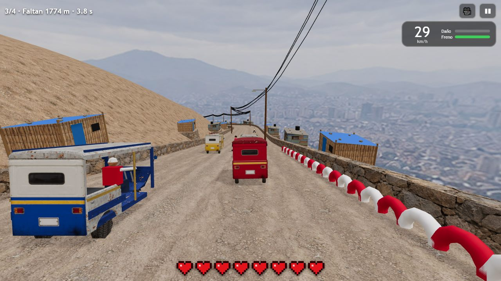
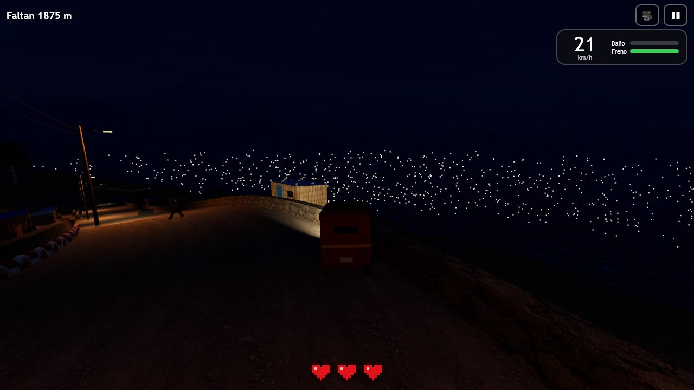

# ¡Torito sin control!

Te cortaron el cable del freno. Baja un cerro de Lima en mototaxi, esquiva lo que venga y llega entero hasta abajo. Simulador 3D para navegador, en celular o PC.

**[▶ Jugar ahora](https://bryanlizana.github.io/test-game-004/)** — no requiere instalación.



| Primera persona | Tercera persona |
|---|---|
|  |  |

| Carrera | Noche |
|---|---|
|  |  |

## De qué se trata

Empiezas en la trocha de tierra del cerro alto y sigues en una sola partida por la avenida, la ciudad, San Isidro, Chorrillos y el malecón hasta la playa. Los primeros 90 m de tierra no tienen muros; después vuelven las pircas. Por el camino cambian los barrios y aparecen baches, rompemuelles, obras, desmonte, tráfico, peatones, perros y gatos.

Al salir del cerro aparece «¡Oh no, ahora el acelerador se trabó!». El motor empuja hasta 60 km/h, recupera velocidad después de frenar y puede superar esa velocidad en las bajadas fuertes. El cerro se conecta con la ciudad mediante un paso bajo nivel, con la ciudad preparada desde el inicio y sin pantalla de carga intermedia. Conservas vidas, daño, freno y tiempo. En la ciudad circulan más carros y bicicletas; los deportivos vienen de frente por el carril contrario. La llegada se celebra en la playa, y OTRA VEZ reinicia desde el cerro.

El freno nunca detiene la moto y solo aguanta 5 segundos: se recarga despacio al soltarlo y, si lo vacías, queda bloqueado 5 segundos. Si tomas una curva muy rápido, el torito se levanta en dos ruedas y se vuelca.

## Modos

| Modo | Vidas | En qué consiste |
|---|---|---|
| **Sin frenos** | 4 | La bajada original, con todos los obstáculos. |
| **Carrera** | 8 | La misma bajada y la misma física contra tres toritos rivales. Hay autos que suben por el carril contrario y personas que cruzan, pero no animales ni obras. |

Se puede jugar de día o de noche, y en primera o tercera persona.

## Controles

| Acción | Celular | PC |
|---|---|---|
| Dirección | Tocar la mitad izquierda o derecha de la pantalla | ← → / A D |
| Freno | Tocar el cuarto inferior de la pantalla | S / ↓ / Espacio |
| Claxon | — | H |
| Cambiar de cámara | 🎥 | C |
| Pausa | ❚❚ | P / Esc |

En celular funciona en vertical y en horizontal.

## Ejecutar en local

El juego no tiene compilación ni dependencias que instalar, pero necesita un servidor HTTP porque usa módulos ES y un Web Worker. Desde la raíz del repositorio:

```sh
python -m http.server 8080
```

Luego abre <http://localhost:8080>. También sirve `npx serve .`. Se necesita conexión a internet, porque Three.js se carga desde jsDelivr.

Para repetir las pruebas de física, controles y geometría (requiere Node.js, sin dependencias):

```sh
node scripts/verificar-juego.mjs
```

## Cómo está hecho

- **Tecnología:** JavaScript en módulos ES y [Three.js](https://threejs.org/) 0.160. El sonido es sintetizado.
- **Mundo procedural:** la calle se genera por bloques a partir de una semilla. Un Web Worker los calcula y se cargan y liberan según avanzas.
- **Texturas e ilustraciones:** generadas con IA. Los prompts están en [`assets/imagegen-prompts.txt`](assets/imagegen-prompts.txt) y [`scripts/texturas-vehiculos.json`](scripts/texturas-vehiculos.json).

| Ruta | Contenido |
|---|---|
| `js/main.js` | Render, cámaras, HUD y flujo de juego |
| `js/pista.js` | Generación de la calle, el terreno y los barrios |
| `js/tramos.js` | Carga y liberación de bloques |
| `js/obrero-pista.js` | Web Worker que calcula los bloques |
| `js/vehiculo.js` | Física: pendiente, freno, vuelco, saltos y choques |
| `js/trafico.js` | Vehículos, rivales, peatones y animales |
| `js/modelos.js` | Modelos 3D procedurales (se ven en `pruebas/modelos.html`) |
| `js/controles.js`, `js/audio.js` | Entrada y sonido |
| `scripts/version.mjs` | Actualiza la versión en todos los archivos: `node scripts/version.mjs X.Y.Z` |
| `scripts/logo-titulo.mjs` | Genera el logo del título en `assets/img/` |

## Licencia

Este proyecto se distribuye bajo la [GNU General Public License v3.0](LICENSE). Three.js, que se carga desde jsDelivr, tiene su propia licencia MIT.
